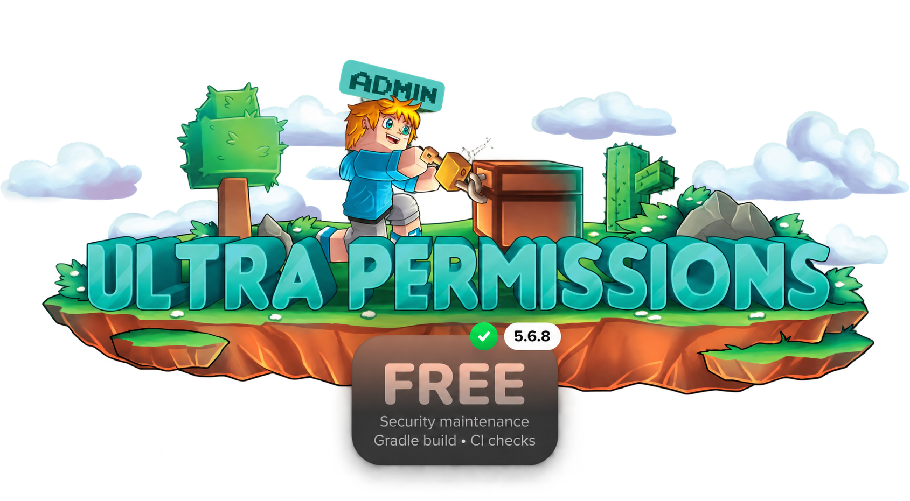

[English](README.md) · [Українська](README.uk.md) · [Русский](README.ru.md)

<p align="center"></p>

<p align="center">
<a href="https://github.com/slyphmp4/UltraPermissions/actions/workflows/ci.yml"></a>
<a href="https://github.com/slyphmp4/UltraPermissions/releases"></a>


</p>

# UltraPermissions

Управление правами, группами и рангами Minecraft через команды и графический редактор. **5.6.12** объединяет девять этапов исправлений стабильности, безопасности, производительности и совместимости, полный перевод на русский и украинский и автоматическую загрузку проверенных стабильных обновлений GitHub Releases (установка при следующем ручном перезапуске).

Мы подготовили самостоятельный Gradle-проект, сохранили основные возможности управления правами, переработали опасные сетевые и SQL-пути и добавили отрицательные тесты безопасности. В этой версии закрыты восемь ранее обнаруженных HIGH/MEDIUM-проблем и дополнительно усилена авторизация административных команд.

Это исправления уязвимостей приложения. Подтверждённых вирусов или намеренного вредоносного импланта в проведённой проверке не установлено, поэтому мы не заявляем «удаление вирусов» или абсолютную безопасность.

## Возможности

- Индивидуальные права и группы: разрешения, запреты `-permission.node`, шаблоны прав и наследование.
- Несколько групп у игрока, приоритеты, временная выдача групп и прав, автоматическое истечение сроков.
- Области действия по миру и серверу; отдельные права для BungeeCord.
- GUI для пользователей, групп, разрешений и цепочек рангов; иконки и настройки отображения.
- Префиксы, суффиксы, цвета, основной/дополнительный ранг и таймеры рангов.
- Повышение/понижение по настраиваемым Group Paths.
- Делегированная выдача разрешённых групп с ограничением времени выдачи.
- Локальное JSON-хранилище или MySQL; подписанная синхронизация между доверенными узлами.
- Интеграции Vault, PlaceholderAPI, MVdWPlaceholderAPI и NametagEdit.
- Перенос данных из LuckPerms/PermissionsEx, копирование групп, перенос аккаунтов и перенос хранилищ File/MySQL.
- Встроенные офлайн-переводы на русский и украинский (по 805 строк интерфейса и 159 названий существ), справочная база узлов прав и журнал проверки прав.

## Скачать и установить

1. Скачайте **UltraPermissions-5.6.12.jar** из [Релизы](https://github.com/slyphmp4/UltraPermissions/releases). `-sources.jar` на сервер не устанавливается.
2. Поместите JAR в `plugins`, убрав другую копию UltraPermissions из той же папки, затем перезапустите сервер.
3. Для начала администрирования выполните **из консоли** `upc AddSuperAdmin ВашНик`, когда пользователь уже зарегистрирован после входа, затем откройте `/uperms`.
4. Для сети или MySQL следуйте [инструкции настройки](docs/CONFIGURATION.ru.md). Все узлы должны использовать эту security-версию.

**Minecraft Java Edition: совместимость до 26.2.** Paper 26.2 / Java 25 проходит изолированные проверки во время выполнения. Предыдущие версии серверов и поддержка прокси описаны в [матрице совместимости](docs/COMPATIBILITY.ru.md). Классы приложения имеют целевой уровень Java 17; сборка использует JDK 21. Это исходный код версии 5.6.12; актуальные опубликованные стабильные выпуски доступны в GitHub Releases.

## Команды и права

Основные команды: `/uperms`, `/upc`, `/promote`, `/demote`.

- [Полный список команд и примеры](docs/COMMANDS.ru.md)
- [Модель доступа и узлы прав](docs/PERMISSIONS.ru.md)
- [PlaceholderAPI и интеграции](docs/PLACEHOLDERS.ru.md)
- [Изменения безопасности и ограничения](docs/SECURITY-CHANGES.ru.md)

## Собрать в IntelliJ IDEA

Откройте папку как Gradle-проект, используйте **Gradle Wrapper** и **JDK 21** в Gradle JVM.

```powershell
.\gradlew.bat clean build --offline
```

Linux/macOS:

```sh
bash ./gradlew clean build --offline
```

Первый запуск Wrapper скачивает Gradle 8.14.5 с проверкой SHA-256. Зависимости плагина закреплены в `libs`, после загрузки Wrapper сборка не требует внешнего Maven-репозитория. Готовые JAR находятся в `build/libs`.

## CI и проверка компонентов

GitHub Actions запускает чистую сборку на **Ubuntu и Windows / JDK 21**. `verifyComponents` проверяет SHA зависимостей, состав JAR, отсутствие серверных API и тестовых классов в плагине, ресурсы, версию, целевой уровень Java и **7085 контрактов API**. `verifySecurityFixes` проверяет подделку/повтор сообщений, связывание параметров SQL, отказ пула, сессии GUI, кодеки предметов, политику TLS и административные ветки команд. Сеть и системные процессы в тестовой JVM заблокированы.

Отдельная проверка запускает плагин на **Paper 26.2 / Java 25** в Docker и выполняет **14 проверок во время выполнения**. У плагина нет доступа к внешней сети. См. [границы проверки и шаги воспроизведения](docs/COMPATIBILITY.ru.md). Тег `v<version>` создаёт стабильный выпуск только после успешных сборок на обеих ОС и проверки на сервере. Файлы выпуска: JAR плагина, JAR исходного кода, полный Gradle-проект и контрольные суммы SHA-256.

## Авторство и лицензии

UltraPermissions — TechsCode; исходные обозначения автора сохранены. Подготовка и сопровождение этой сборки сообщества с исправлениями безопасности — **slyphmp4**. Лицензия репозитория: [GPL-3.0](LICENSE); сторонние компоненты сохраняют собственные лицензии, см. [THIRD-PARTY.md](THIRD-PARTY.ru.md) и `META-INF` в поставке.
